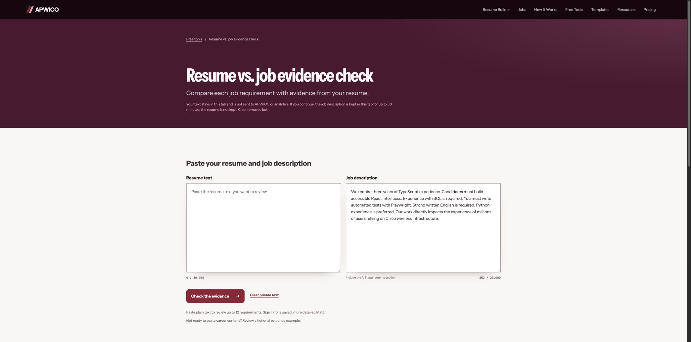

# Live browser audit — 29 October 2026

Audited production release 1fbc627 with the owner's existing signed-in test account. Only fictional resume/application content was added. This is a sampled browser audit, not proof that all defects have been found.

## Prioritized defects

| ID | Priority | Reproduction / actual result | Fix | Status |
|---|---|---|---|---|
| UI-1 | P1 | Homepage headline's final sentence clips at desktop width; nowrap spans exceed the copy column. | Allow all heading lines to wrap and remove inherited indent. | Fixed in merged PR #2 (236a207); build and desktop/mobile browser inspection pass. |
| F-1 | P1 | Search Java Full Stack Developer, US, Enter criteria. Results label “Our work directly impacts the experience of millions of users relying on Cisco wireless infrastructure” and “Join one of the world's most renowned global banks…” as important required qualifications. | Exclude company promotion/context from requirements; retain source classification; regress with real paragraph fixtures. | Fixed in this patch; regression covered. |
| F-2 | P1 | Quick-add company/role without description, then Prepare and start the free trial. A job-specific version is created; only later does AI panel say there is no description and cannot generate suggestions. No description editor was offered along this tested path. | Ask for/review a posting before reserving the single trial, or explicitly explain the limitation before commitment and provide a description edit path. | New trials protected on client and server; quick-add now accepts posting text. Existing blank snapshots are preserved; the prior fictional trial remains attached to its original record. Editing existing posting snapshots is still a limitation. |
| F-3 | P1 | Public extractor input: “We require three years of TypeScript experience. Candidates must build accessible React interfaces. Experience with SQL is required. You must write automated tests with Playwright. Strong written English is required. Python experience is preferred.” Output: 4 required, 1 preferred; required English is missing. | Preserve explicit language requirements; add paragraph/list regression fixture. | Fixed in this patch; regression covered. |
| UI-2 | P2 | Match Analysis screen highlights Opportunities in journey rail. Tailored editor can highlight Resume. | Derive active step from match route and active saved version. | Fixed in merged PR #2 (236a207). |
| UI-3 | P2 | Job-specific editor sidebar says “Build your master resume.” | Show job-specific editing label when a saved version is active. | Fixed in merged PR #2 (236a207). |
| UI-4 | P2 | Preferences browser tab says “My applications”; Match says “Discover jobs”; tracker routes share page key so titles can remain stale. | Route-specific titles and refresh when route kind changes. | Fixed in merged PR #2 (236a207). |
| F-4 | P2 | Extract requirements, then click “Compare these requirements with your resume.” Comparison opens with job description empty. | Carry the job text within the same tab with explicit privacy-consistent handoff, or label link clearly as a fresh tool. | Fixed in this patch; regression covered. |
| F-5 | P2 | Manual application with no posting text still receives a negative “limited demonstrated alignment” assessment after Match refresh. | Show insufficient posting/resume evidence instead of an alignment verdict when required inputs are absent. | Fixed in this patch; regression covered. |
| UI-5 | P2 | Returning from saved version to Discover briefly shows 0/10 saved allowance before settling to correct 1/100; old saved-version status remains visible alongside master-draft status. | Use explicit loading state for allowance/account data and scope status to active document. | Fixed: account loading state and master save-status reset. |

## Tested flows and results

1. Homepage desktop/mobile: headline clipping confirmed; corrected local homepage wraps and buttons remain usable.
2. Preferences steps 1–2: usable and optional skip/save controls visible; wrong page title confirmed. Remaining steps not completed.
3. Tracker quick-add: fictional record created, count increased to 1/100, notes and next action persisted.
4. Application detail and Match: detail loads; matching returns; missing-description problems above confirmed.
5. Free tailoring trial: saved version created; editing personal details, profile, experience, education and design works; save status returns to account-saved. No actual AI generation occurred because posting description is absent.
6. Export: confirmation/consent UI and 7/7 allowance load. Actual PDF/Word generation blocked by automatic approval review at upload-consent checkbox; no downloads consumed.
7. Discovery: live manual search returns three jobs; list/card switch, Pass and Undo work. Did not apply externally.
8. Pricing/Pro: price and limits present; checkout gated by recurring consent; no purchase, subscription alteration, or charge.
9. Templates/Scholar: catalog and detail page load; Scholar now uses an academic fictional sample.
10. Free extractor/comparison: explicit language omission and lost handoff found.
11. Resources: index and internal destinations inspected; individual articles not exhaustively visited.

## Validation and limits

Production build passes for UI patch. Local Playwright could not launch Chromium because host sandbox denied MachPortRendezvous (not an assertion failure). CI run for PR #2 is the browser regression authority. No database or billing changes in UI patch. Original worktrees and dirty HANDOFF/review files preserved; isolated checkout /tmp/apwico-ui-audit.

Not verified: actual PDF/Word output, AI output, payment/webhooks, fresh login/logout and second-account isolation, CSV roundtrip, full screen-reader behavior, all pages/templates, every breakpoint. Browser viewport capture produced inconsistent scaling on some existing tabs; those screenshots are not accepted as visual evidence.

Fictional test record: “APWICO QA — Fictional Company / QA Software Engineer”, application 22ccf4e0-3149-484f-8ed1-32f223070ccc, saved version 50a8d08a-1059-43da-92bd-ca4450e3078d. Left intact for reproduction; no deletion performed.

## Release verification

GitHub Actions quality gate run 40814982968 passed for e1233e9. PR #2 merged as 236a207af1394a87a9756e4e563969066bc6b0ec. Vercel production deployment GRqeb9TKJP2boa4jaZWe7pRccweq is Ready in Production. Live homepage wrapping and Job preferences title were verified after deployment.

## Follow-up patch verification

- Server tests: 526 passed, including missing-description trial protection, explicit language extraction, company promotion exclusion and insufficient posting assessment.
- Local connected Chrome: paragraph fixture returns five required and one preferred requirement; comparison retains posting text and leaves resume input empty.
- Automated local Chromium remains unavailable due to host sandbox launch restrictions; GitHub Actions includes the public-tools regression suite in addition to the full quality gate.
- No database migrations, billing configuration, quota resets or historical document rewrites in this patch.

## Production follow-up completed

- PR #3 merged as 71d966f3da1dcb0d79ae8b13c3babed59e62b44c after CI run 40819145970 passed all 13 quality-gate checks plus all 10 public-tool browser tests. Tested source: 7158b20b1ca95a59dbfb6aa62a1c622c091dfb5b.
- Vercel deployment dpl_vu5QkZ44ZuNqSL46RFKuC7S6P9B1 is Ready in Production and assigned to apwico.com.
- Live verification: five required plus one preferred extracted from the paragraph fixture; promotional sentence excluded; all posting text carried into comparison with resume blank; missing-posting Match hides the old verdict; quick-add posting field visible and count remains 1/100.
- Actual hosted export remains unverified: automatic approval review rejected the upload-consent action and requires explicit approval to send the fictional Alex QA resume to APWICO. No upload or download was performed.
- No guarantee of universal defect freedom. Existing blank posting snapshots still cannot be edited in place; their resumes remain manually editable/exportable, and no historical data was rewritten.
- Rollback: restore prior Vercel deployment dpl_GRqeb9TKJP2boa4jaZWe7pRccweq (236a207). This patch requires no database rollback.

